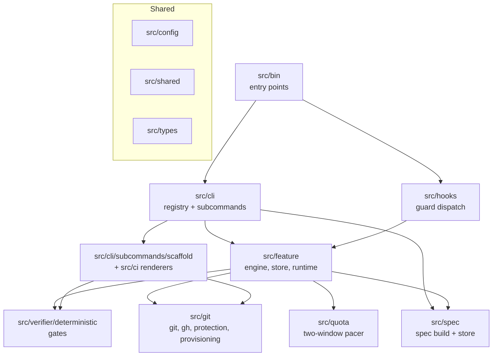

# Components

The engine is organized into modules under `src/`, each owning one concern. For
the system-level picture see [overview.md](./overview.md).

## Entry points (`src/bin`)

`factory.ts` and `factory-hook.ts` are the only places that call `process.exit`.
They are bundled to `dist/factory.js` and `dist/factory-hook.js`.
`shard-mutation-scope.ts` is bundled to the managed CI helper
`templates/.github/scripts/shard-mutation-scope.mjs`.

## CLI (`src/cli`)

`main.ts` holds the subcommand registry and `dispatch()`. `args.ts` parses flags
(unknown flags are usage errors) and `io.ts` emits JSON. The feature commands
(`run`, `resume`, `debug`, `next-action`, `next-task`, `state`) are built by
`featureCommand` in `src/feature/cli.ts`. `subcommands/` holds `spec`, `scaffold`
(with `scaffold-gates.ts` and `scaffold-lock.ts`), `configure`, `autonomy` and
`statusline`. See [reference/cli.md](../reference/cli.md).

## Feature engine (`src/feature`)

The v2 execution core.

| File               | Responsibility                                                                                                  |
| ------------------ | --------------------------------------------------------------------------------------------------------------- |
| `schema.ts`        | Zod schemas: feature spec, run, attempt, claims, agent results, actions; repair and batch constants.            |
| `engine.ts`        | `FeatureEngine`: create, advance, stop, resume; stage transitions, re-issue, transient retries, repair budgets. |
| `store.ts`         | `FeatureStore`: atomic state and ledger writes, repository lock, briefs, staged results, rejection files.       |
| `runtime.ts`       | `LocalFeatureRuntime`: git, gates, review snapshots, quota, base reconcile, delivery through `gh`.              |
| `ports.ts`         | The runtime interface and the `ResultRejected` and `TransientFailure` signals.                                  |
| `brief.ts`         | Renders each role's Markdown brief and the acceptance IDs.                                                      |
| `preflight.ts`     | Run-creation checks: gate contract present, base-branch protection sufficient.                                  |
| `test-evidence.ts` | Parses executed-test counts, assertion failures and load failures from test output.                             |
| `cli.ts`           | The feature subcommands.                                                                                        |

The engine depends on the `FeatureRuntime` interface, not on git or `gh`
directly, so transitions are tested against a fake runtime. See
[reference/state-model.md](../reference/state-model.md).

## Spec (`src/spec`)

PRD-to-spec generation: `build.ts` (the resolve, gate and store actions and the
bounded revision loop), `gates.ts` (deterministic spec gates and PRD requirement
extraction), `review.ts` (56/60 plus dimension-floor adjudication), `execution.ts`
(dependency order and safe paths), `snapshot.ts` (base commit and repository
contracts), `store.ts` and `paths.ts` (the durable spec store), `gh.ts` (PRD
fetch) and `agents.ts` (the pinned generator and reviewer model).

## Verifier (`src/verifier/deterministic`)

The `GateRunner`, per-gate strategies (test, tdd, coverage, mutation, sast, type,
lint, build), tool wrappers that resolve local binaries, the gate contract
(`.factory/gates.json`) schema and loaders, the TDD classifier, test-path scoping,
and `db-detect.ts` for the database reviewer trigger. See
[reference/automated-gates.md](../reference/automated-gates.md).

## Git (`src/git`)

`git-client.ts` and `gh-client.ts` wrap the CLIs. `base-branch.ts` resolves the
base branch. `protection.ts` computes required checks (`effectiveProfiles`),
checks protection and strengthens it during scaffold. `provision.ts` installs
dependencies in a new worktree (`quality.setupCommand` or lockfile detection).
`repo.ts` resolves `owner/name` from `origin`.

## Quota (`src/quota`)

`usage-source.ts` reads the statusline usage cache, `window.ts` computes window
position and boundaries, and `pacer.ts` evaluates the two curves. See
[explanation/quota-pacing.md](../explanation/quota-pacing.md).

## CI rendering (`src/ci`)

`render-quality-gate.ts` renders the managed `quality-gate.yml` from the gate
contract and base branch; `inject-gate-env.ts` writes `quality.gateEnv` into it;
`node-runtime.ts` picks the target repo's committed Node version declaration (`.node-version`, `.nvmrc` or `package.json`) for setup-node.

## Hooks (`src/hooks`)

The `factory-hook` dispatcher (`main.ts`) and its guards: `feature-guards`
(producer scope and publication ownership, plus the Stop hook),
`write-protection` (TCB paths, `tcb.ts`), `branch-protection`, `secret-guard`
and `session-start` (the post-compaction run reminder). See
[reference/hooks.md](../reference/hooks.md).

## Autonomy (`src/autonomy`)

`mode.ts` reads `FACTORY_AUTONOMOUS_MODE`. The `factory autonomy` subcommand
builds the autonomous relaunch command.

## Config and shared (`src/config`, `src/shared`, `src/types`)

`src/config` holds the single Zod config schema with all defaults, loading and
sparse-overlay saving. See [reference/configuration.md](../reference/configuration.md).
`src/shared` holds cross-cutting primitives: exit codes, atomic writes, file
locks, exec, JSON helpers, logging, secret patterns and the command allowlist.
`src/types/tcb.ts` holds the TCB types.

Leaf modules (`src/shared/exit-codes.ts`, `src/cli/registry-types.ts`,
`src/hooks/registry-types.ts`, `src/types/tcb.ts`) exist to break import cycles.
The no-circular-dependency rule is a `verify` gate (`check:circular`).

The v1 modules (`src/orchestrator`, `src/core`, `src/producer`, `src/scoring`,
`src/rescue`, `src/debug`, and the judgment, holdout and e2e verifiers) were removed; they are preserved at the git
tag `archive/v1-engine`.
