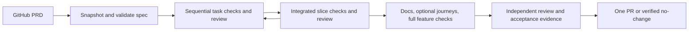

# Architecture overview

Factory v2 delivers one PRD on one feature branch, with sequential tasks and one
PR. It separates agent judgment from durable control flow. The CLI owns all state
transitions; the session runner dispatches the exact persisted attempt.

## Durable state

`$CLAUDE_PLUGIN_DATA/runs-v2/<id>/state.json` stores the complete spec, accepted
checkpoints, active attempt, answers, repair counters and delivery observation.
Atomic state writes are serialized by a repository lock. Agents' raw results are
staged per role under `staged-v2/`, validated, and journaled once accepted.
`ledger.md` is the human-readable audit.

An attempt binds its driver, stage, spec digest, base SHA, HEAD SHA and worktree.
Repeated next-action calls wait for the existing attempt. A fresh process resumes
from disk and may consume the staged results of an earlier driver. Explicit
recovery consumes a complete staged result, redispatches only a partial panel's
missing roles, or retires a stopped worker's lease, preserving work. Stale
results are rejected.
A parked run never resumes merely because time elapsed or quota recovered.

## Specs and integration

Production specs live under `$CLAUDE_PLUGIN_DATA/v2/specs/`. Each `feature.json`
freezes the PRD, base commit, repository contracts and task graph. The base branch
is `git.baseBranch` when set, and it must exist on origin. When unset it is `develop`
if origin has it, else origin's default branch. The resolved name is recorded on
the run and never written back to config. The spec generator and reviewer read an
engine-written brief and write their own JSON result file; the runner never copies
it, and a missing result spends one bounded regeneration. A result may arrive
wrapped in a fence or prose; the parser reads the JSON object inside and the file
stays verbatim. Run creation
revalidates live PRD/base inputs. Every requirement has an ID and coverage mapping.
Tasks have exact safe paths, explicit shared-file dependencies and contiguous
slice membership. There is no file-count ceiling.

One worktree at `.claude/worktrees/feature-<id>` accumulates accepted work.
Review attempts receive detached snapshots of exact commits. A snapshot is removed
once its attempt is accepted or retired; a failed removal is audited and never
blocks the run. The runner must not request native Agent worktree isolation.
Accepted work is never reset.

## Verification and repairs

Nonexempt tasks establish a passing baseline, commit meaningful failing assertions,
then implement. The tests stage is RED in three ways. The first is a failing
assertion. The second is a load failure whose missing import is a task-declared
file absent at the task base. The third is tests vitest cannot run (pgTAP, Go),
which waives RED with an audit row and leaves their pass/fail to the PR's CI.
GREEN still requires the same tests to pass. TDD is checked on the unsquashed history. The exemption comes from
the frozen task spec or baseline package manifest, not producer-edited settings.
Executed-test counts are required; unsupported reporters stop with a clear error.

Tasks receive tests/type/lint and quality review. task-check runs the full vitest
suite, so an unrelated regression is repaired at its task rather than parked later. Slice and feature boundaries
run broader integrated gates and the review panel, adding database review when
the diff requires it. Citations are checked before independent confirmation.
Confirmation runs in batches of two claims per finding-verifier attempt; confirmed
blockers accumulate in state until the last batch decides repair or pass. A
tests-stage `already-satisfied` is accepted only when every commit since the task
checkpoint is a tagged test-only commit (none is fine); otherwise the run parks as
a producer failure, because the test-writer cannot undo an implementation commit.
The ordering check is then skipped because there is no implementation commit to
order.
After a repair, the re-review at that boundary judges only the repair diff and
whether the prior confirmed claims are resolved. Repeated repairs keep the first
repair's base, so the diff spans every round. When a confirmed claim cites a test,
the implementer may strengthen that test but never loosen or remove an assertion.
Task and slice reviews cover their own ranges. Feature review and acceptance
cover the range from the merge-base with the base branch, so upstream changes
merged during the run are not reviewed as feature code.
Acceptance evaluation is independent, covers every requested ID, and sees all
criteria. Producer claims and unrelated green tests cannot establish acceptance.

Execution has three repair passes per boundary; spec generation has five revisions.
The producer dispatch of a boundary's final repair pass runs on Opus; the attempt
records the override, re-issues keep it, and the ledger audits it.

Agent statuses self-heal. `needs-context` from any role routes to spec repair,
spending the spec repair budget: the spec generator receives the asking role and
its question and makes the spec decide. A question raised during spec repair or
spec review, or once the spec budget is spent, parks for `resume --answer`. In a
review panel any non-done status wins and the other reviewers' claims are dropped.
`blocked` re-issues the role like an invalid result; a third `blocked` parks as
an environment failure. A spec generator `blocked` during spec repair parks as a
spec failure whose question `resume --answer` supplies. `spec-defect` routes to
spec repair.
A clean base merge triggers full verification without spending a producer repair
pass. Conflicts preserve both sides for forward repair. CI waiting has a deadline
and consumes no implementation pass.

Final acceptance persists the verified feature HEAD and spec digest. Delivery must
match both, including after an interruption between Git integration and the state
write. An invalid staged result is set aside and re-issued with the reason, at most
twice, then parked. Its files are retained, and repair passes are not spent.
Transient failures are waited out and retried, up to five in a row, before the run
parks. These include git fetch and push, gh PR and check reads, worktree
installs and flaky tests. A Vitest test-gate failure with executed tests on an
expected-green tree (any check stage except a RED tests stage; the pre-test
baseline counts) reruns only the failing test files. If they pass, the whole check
is retried as transient; a repeated failure is repaired as before. The gate passes
only on a clean full run, and contract-command test gates are not rerun. A clean
call resets the count. Quota waits last until the next
usage-window boundary, clamped to 60 to 3600 seconds; unreadable usage is rechecked every 60 seconds.
Explicit recovery consumes a corrected result or retires the attempt and schedules
replacement evidence without discarding work.

## Delivery and protection

The engine recovers PR identity by branch, pushes normally and observes the exact
reviewed HEAD. Live runs complete only after an observed merge. No-ship and debug
runs end ready for review. Local runs park after full verification and before any
remote write until resume authorizes live or no-ship delivery. A verified empty feature completes without an empty PR.
Merge observation precedes no-change detection, including after interrupted delivery.

Scaffolding requires a stable strict branch profile. Existing sufficient protection
is untouched. Strengthening updates only required status checks and preserves
existing check app bindings and unrelated review/admin/restriction policy.
No run lifecycle transition changes branch protection.

## Version boundary

This is a clean major break. Old run/spec artifacts remain available but cannot
execute or migrate automatically. The v1 source has been removed; it is preserved
at the git tag `archive/v1-engine`.
See [CLI reference](../reference/cli.md) and [release ledger](../proposals/sequential-feature-delivery.md).
