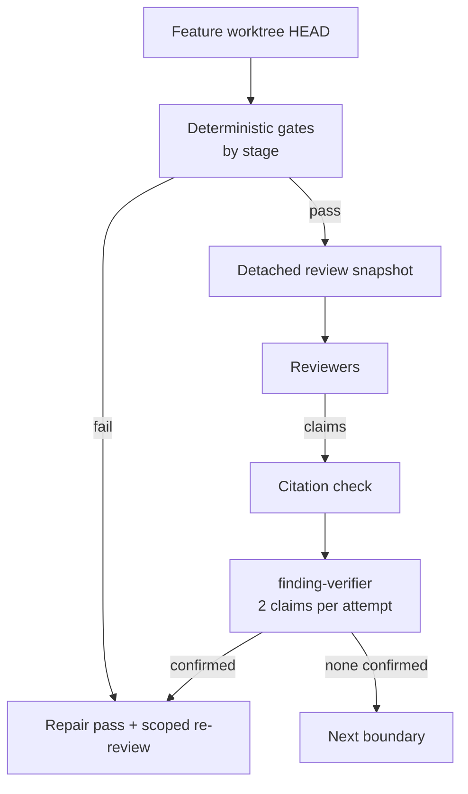

# The Verifier

The verifier decides whether producer work is accepted. It has two layers: a
deterministic layer of executed gates, and a judgment layer of independent
reviewers whose findings must survive an independent check before they cost a
repair. This page explains why it is shaped that way. The precise gate sets,
roles and rules are in [automated gates](../reference/automated-gates.md).

## Evidence, not claims

A producer's report is never evidence. A gate passes only when a command actually
executed and produced a pass signal; a check that ran zero tests is not a passing
test check. Acceptance comes from a separate `acceptance-evaluator` that must
answer every requirement and acceptance criterion with evidence. Green tests
unrelated to a criterion, or a producer saying "done", cannot satisfy it.

The engine also derives sensitive facts from sources the producer cannot edit.
The TDD exemption comes from the frozen spec or from `package.json` at the spec's
base commit, not from the working tree. Review identity comes from the staged file
path, not from a field the agent writes.

## Review on immutable snapshots

Reviewers work in a detached worktree at the exact HEAD under review. The engine
checks that the snapshot is unchanged when the result arrives; a modified
snapshot invalidates the evidence and a fresh attempt is issued. This keeps
reviewers from "fixing" what they review and makes every citation refer to one
known tree. Snapshots are removed once consumed, so they do not accumulate.

## Who reviews

Task review uses the `quality-reviewer` alone. Slice and feature boundaries use a
fixed panel of four lenses: quality, implementation (spec alignment), silent
failures, and systemic failures across stages. `database-design-reviewer` joins
when the review range touches database paths.

The panel does not shrink for low-risk work. Under-review is the expensive failure
in an unattended pipeline: a misclassified risky change reviewed narrowly ships a
defect silently. Making the panel depend only on the stage and on a deterministic
fact about the diff removes risk classification from the verifier's blast radius.
The database specialist is additive and triggered by file paths, not by judgment.

## Verify, then fix

Reviewers over-report. If every claim triggered a repair, false positives would
burn the three repair passes a boundary has, and a run could park on findings
that were never real. So a claim must clear two checks first:

1. **Citation.** Its quote must appear within two lines of the cited line in the
   reviewed tree. A fabricated or misplaced citation rejects that reviewer's
   result, which is re-issued with the reason.
2. **Independent confirmation.** A separate `finding-verifier` judges each claim,
   two per attempt, on a fresh snapshot. Only confirmed claims become repair
   feedback.

Refuted claims are listed in later reviewer briefs. A reviewer may raise one
again only with new evidence, which stops the same false positive from returning
every round.

## Scoped re-review

After a repair, the next review at that boundary judges only the repair diff
plus whether the prior confirmed claims are resolved. Repeated repairs keep the
first repair's base, so the diff covers every round. Without this, each re-review
would audit the whole range again and could surface new, unrelated findings each
time, so a boundary might never converge within its repair passes.

Feature review and acceptance start from the merge-base with the base branch. If
upstream changes are merged into the feature during the run, they are not
reviewed as if they were feature code.

## Why gates exec local bins, never `npx`

The command-running gates (`test`, `type`, `lint`, `mutation`) resolve and exec
the worktree's own `node_modules/.bin/<tool>` (see
[the gate-resolution reference](../reference/automated-gates.md#how-a-command-gate-resolves-its-tool)),
never `npx <tool>`. Under corepack with a `packageManager: pnpm@…` field
(node ≥ 24), a bare `npx <tool>` bypasses the installed `node_modules/.bin` and
resolves a remote registry package of the same name instead. For example, `npx tsc`
fetches an unrelated `tsc` package and exits 1, a false type-gate failure
independent of the code under test. Executing the local bin directly is
package-manager-agnostic and never touches the network; when no local bin
resolves the gate fails closed rather than falling back to `npx`.

## See also

- [Automated gates](../reference/automated-gates.md): gates by stage, RED kinds,
  review roles.
- [Architecture overview](../architecture/overview.md#verification-and-repairs).
- [Model A](./model-a.md): why the engine, not an agent, owns these decisions.
